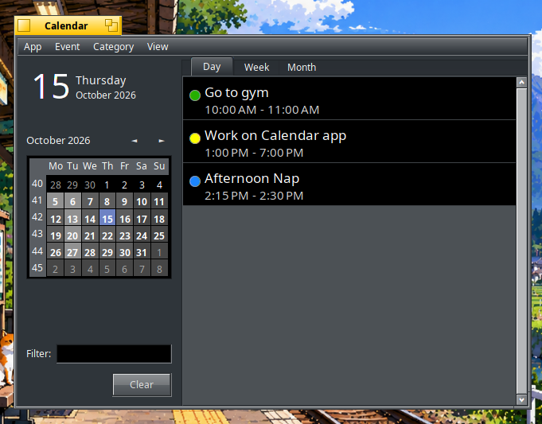

#  Calendar for [Haiku](https://www.haiku-os.org/)    

Calendar is a native Haiku application to manage your appointments.

You can create, edit and delete events, and cancel or hide them, categorise
events and show them in a day, week or month view. Calendar now has many improvements,
including a Deskbar replicant icon showing the current date, hey scripting support and
the Event menu provides Calendar's own scheduled task launcher.



---

This project was originally written by a dedicated team of talented coders who laid a strong and thoughtful foundation. Over time, however, the code fell dormant — left unmaintained, its dependencies stale and its tooling obsolete. Rather than start over, I have brought new life to the project: modernizing the existing base, reviving its momentum, and extending the application toward its original promise. The goal is simple: to make it the best app on Haiku. Credit to the original authors, whose work this builds directly upon.

 **The goal is simple:** to make it the best Calendar app on Haiku.

Credit to the original authors, whose work this builds directly upon.


>Sikosis · **Maintainer** · [GitHub](https://github.com/sikosis)

---

## Building on 32-bit Haiku

> [!IMPORTANT]
> When building on 32-bit Haiku, you must change the build environment to use `gcc11` with `setarch x86` **before** invoking `make`.

---

## Build

From the `main` directory, run:

```sh
make
make bindcatalogs
```

---

## Tests

```sh
cd tests
make test
```

---

## Package

On Haiku, build and test an installable package from the repository root:

```sh
packaging/build-hpkg.sh
```

The package is written to:

```
packages/calendar-0.6.0-1-<architecture>.hpkg
```

Install it with `pkgman`, substituting the generated filename:

```sh
pkgman install ./packages/calendar-0.6.0-1-x86_64.hpkg
```

Calendar stores and launches scheduled tasks itself. Its persistent Deskbar
replicant checks tasks once per minute, including while the main window is
closed.

For a secondary 32-bit build on 64-bit Haiku, run:

```sh
setarch x86 packaging/build-hpkg.sh
```

> [!WARNING]
> The builder does not overwrite an existing package of the same version and revision. Move the existing package aside or increase the package revision before rebuilding it.

---

## Scripting

Calendar supports Haiku scripting through `hey`. Use `hey Calendar GETSUITES` to inspect the complete vocabulary.

| Action | Example |
|--------|---------|
| Get version | `hey Calendar GET Version` |
| Get date | `hey Calendar GET SelectedDate` |
| Set date | `hey Calendar SET SelectedDate TO "2026-10-15"` |
| Get view | `hey Calendar GET View` |
| Set view | `hey Calendar SET View TO week` |
| Jump to today | `hey Calendar DO Today` |
| New event | `hey Calendar DO NewEvent` |
| Manage categories | `hey Calendar DO ManageCategories` |

---

## 📚 Documentation

For more information, please see the [Calendar documentation](documentation/Documentation.html).

---

